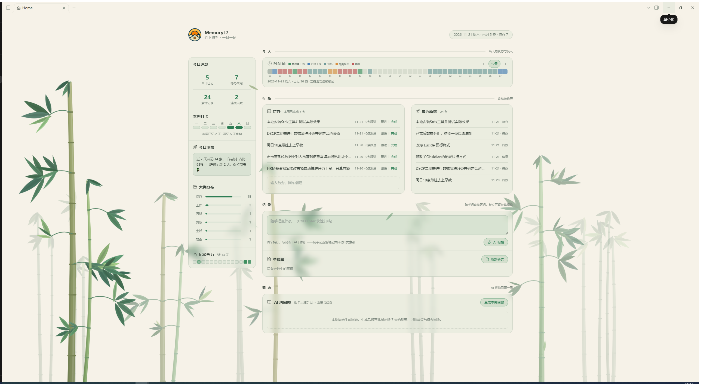

# Home Dashboard

<p align="center">
  
</p>

一个 [Obsidian](https://obsidian.md) 首页插件:打开 Obsidian 就能看到一个汇总了随手记、待办、日记和回顾的首页,配上会轻轻摇动的竹林背景。



## 它能做什么

- **打开就是首页**:启动 Obsidian 后自动进入 Home 页面,不用自己找笔记
- **随手记**:想到什么就输什么,回车保存,可以自动整理到对应的笔记里
- **待办**:在首页直接看到要做的事、最近新增的条目,也能直接添加
- **一日一记**:按天记录自己的状态和投入
- **一周回顾**:让 AI 帮你回顾最近 7 天的记录,给出观察和建议
- **今日速览**:今天记了几条、还有几件事没做完、连续记录了多少天
- **本周打卡**:一眼看到这一周哪几天记了、哪几天还没记
- **时间轴**:一天当中什么时候记了什么,左右滑动看详情
- **草稿箱**:没写完的长文先放这里,随时接着写
- **竹林背景**:会随风摆动的竹林,让首页不那么枯燥
- **跟随主题**:Obsidian 切换深色、浅色,首页也会跟着变

## 安装

从 [Releases](https://github.com/MemoryL7/home-dashboard/releases) 下载
`main.js`、`manifest.json`、`styles.css` 三个文件,放进
`<vault>/.obsidian/plugins/home-dashboard/` 文件夹,然后在 Obsidian
设置的"第三方插件"里启用 Home Dashboard。

也可以自己从源码构建:

```bash
npm install
npm run build
```

构建后同样把 `main.js`、`manifest.json`、`styles.css`
复制到上面的文件夹并启用。

## License

[MIT](LICENSE)

---

## English

An [Obsidian](https://obsidian.md) plugin that turns a vault into a personal
dashboard: open Obsidian and you land on a Home page that gathers your quick
notes, todos, daily logs and weekly reviews — with a gently swaying bamboo
garden in the background.


### What it does

- **Home on launch**: the dashboard opens automatically when Obsidian starts
- **Quick capture**: type a thought, press Enter, and it is saved — and can
  be filed into the right note automatically
- **Todos**: see what is due and what was recently added, add new ones
  directly from the dashboard
- **Daily log**: record how your day went
- **Weekly review**: let AI look back over your last 7 days and offer
  observations and suggestions
- **Today at a glance**: notes captured today, open todos, and your current
  streak
- **Weekly check-in**: see at a glance which days you logged this week
- **Timeline**: when during the day you captured what; slide to see details
- **Drafts**: park unfinished longform pieces and pick them up anytime
- **Bamboo garden**: an animated bamboo grove that sways in the wind
- **Theme aware**: follows Obsidian's light and dark themes

### Install

Download `main.js`, `manifest.json` and `styles.css` from
[Releases](https://github.com/MemoryL7/home-dashboard/releases) into
`<vault>/.obsidian/plugins/home-dashboard/` and enable the plugin, or build
from source:

```bash
npm install
npm run build
```
