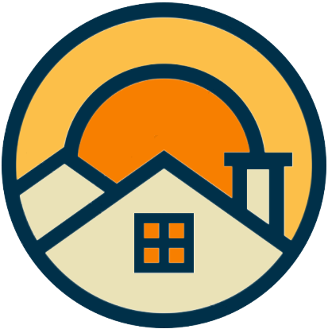
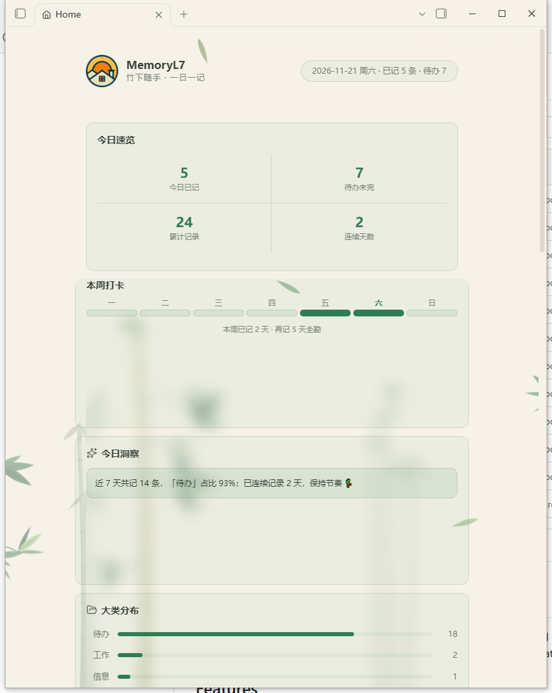

# Home Dashboard

<p align="center">
  
</p>

一个为个人知识库打造的 [Obsidian](https://obsidian.md) 首页仪表盘插件:打开 Obsidian 即进入统一的 Home 视图,集随手记速记、收集箱分拣、待办、一日一记、周回顾、统计与竹林庭院背景于一体。



## 功能特性

- 启动自动打开 Home 仪表盘视图,统一入口
- 随手记快速捕捉,支持 AI 辅助分类
- 收集箱、待办、一日一记、长文写作、周回顾面板
- 今日速览 / 本周打卡 / 今日洞察 / 大类分布等统计视图
- rAF 驱动的竹林庭院动态背景
- 通过 CSS 变量适配明暗主题

## 安装

### 从 Release 安装

从 [Releases](https://github.com/MemoryL7/home-dashboard/releases) 下载 `main.js`、`manifest.json`、`styles.css`,放入
`<vault>/.obsidian/plugins/home-dashboard/`,然后在 Obsidian 的
"第三方插件"设置中启用。

### 从源码构建

```bash
npm install
npm run build
```

将 `main.js`、`manifest.json`、`styles.css` 复制到
`<vault>/.obsidian/plugins/home-dashboard/` 并启用插件。

## 开发

```bash
npm run dev     # watch 构建
npm run build   # 类型检查 + 生产构建
npm test        # 构建并运行 tests/ 下的 node:test 测试
```

源码在 `src/`,纯逻辑模块在 `src/lib/`,对应测试在 `tests/`。

## License

[MIT](LICENSE)

---

## English

An [Obsidian](https://obsidian.md) plugin that provides a "Home" dashboard
view for a personal note-taking vault: quick capture, inbox triage, todo /
day-log / weekly-review panels, note statistics, and an animated garden
background.

### Features

- Home dashboard view that opens automatically at startup
- Quick capture with AI-assisted classification
- Inbox, todo, day-log, longform and weekly-review panels
- Note statistics view
- Animated garden background with rAF-driven sway
- Theme-aware (light / dark) styling via CSS variables

### Install

Download `main.js`, `manifest.json` and `styles.css` from
[Releases](https://github.com/MemoryL7/home-dashboard/releases) into
`<vault>/.obsidian/plugins/home-dashboard/` and enable the plugin, or build
from source:

```bash
npm install
npm run build
```

### Development

```bash
npm run dev     # watch build
npm run build   # type-check + production build
npm test        # build + run node:test suite in tests/
```
